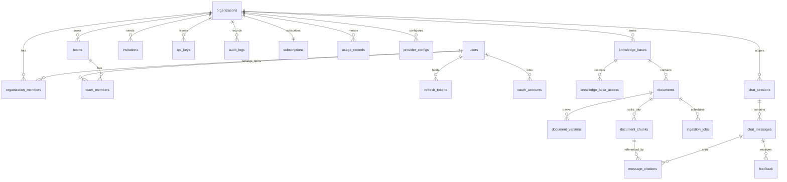

# KnowledgeForge AI

Production-ready B2B multi-tenant AI Knowledge Base & RAG SaaS built with **Python 3.12, FastAPI, SQLAlchemy 2.0 async, PostgreSQL 16 + pgvector, Redis, Celery, S3/MinIO**, and a **Next.js + TypeScript + Tailwind CSS** frontend.

---

## 1. Architecture & Key Security Decisions

### System Architecture
- **API Layer (`app/api/v1`)**: Thin async FastAPI handlers validating inputs via Pydantic v2, enforcing RBAC via `require_permissions()`, and delegating all business logic to services.
- **Tenant Isolation (`app/core/tenant.py`, `app/repositories/base.py`)**:
  - Every tenant-owned table includes a non-null `organization_id` foreign key and index.
  - `get_current_tenant()` resolves the active tenant from the authenticated user's `OrganizationMember` record combined with `X-Organization-ID` header, subdomain, or API key's bound `organization_id`.
  - **Never trusts `organization_id` from client JSON request bodies.**
  - `TenantRepository[ModelT]` mandates `organization_id` filtering on every `get`, `list`, and mutation query.
  - Optional defense-in-depth PostgreSQL Row-Level Security (`app/db/rls_policies.sql`) sets `app.current_organization_id` transaction-locally (`SET LOCAL`) when `ENABLE_POSTGRES_RLS=true`.
- **Document Ingestion Pipeline (`Celery` + `S3/MinIO` + `pgvector`)**:
  - Validates file extension, MIME type, and size limit (`MAX_UPLOAD_SIZE_MB`), runs pluggable virus scanning (`ClamAV` / `NoOp`), computes SHA-256 checksum for deduplication, stores encrypted/private objects under `organizations/{org_id}/knowledge_bases/{kb_id}/...`, and queues background extraction/chunking/embedding tasks in Celery.
  - Website URL ingestion includes an SSRF guard rejecting private, loopback, link-local, and reserved IP ranges.
- **Hybrid RAG with Grounded Citations (`app/services/retrieval_service.py`, `rag_service.py`)**:
  - Combines **pgvector cosine similarity** (`hnsw` index) with **PostgreSQL full-text search** (`ts_rank_cd` over `GIN`-indexed `tsvector`), metadata filtering, and cross-term reranking.
  - Enforces a minimum confidence score threshold (`min_confidence_score`) and returns structured citations referencing exact `document_id`, `chunk_id`, `page_number`, `excerpt`, and `relevance_score`.
- **Authentication & Secrets**:
  - Argon2id password hashing (`argon2-cffi`).
  - Short-lived JWT access tokens + rotating refresh tokens with **token-family reuse detection** (reusing a rotated token revokes the entire session family).
  - Programmatic API keys (`kf_live_...`) are SHA-256 hashed at rest and revealed only once upon creation.
  - Stored external LLM provider keys are encrypted at rest with Fernet (`cryptography`).
  - Redis sliding-window rate limiting and failed login lockout.

### CSRF Strategy (Cookie Auth vs. Bearer Header Auth)
- Default API clients authenticate via `Authorization: Bearer <jwt>` or `X-API-Key: <key>`, which browsers never auto-attach to cross-origin requests (inherently CSRF-safe).
- If `COOKIE_AUTH_ENABLED=true` is enabled for browser cookie sessions, pair `HttpOnly; Secure; SameSite=Lax` cookies with a double-submit `X-CSRF-Token` header verified on all state-changing (`POST`, `PUT`, `PATCH`, `DELETE`) requests.

---

## 2. Database ERD (Mermaid)



---

## 3. Running Locally

### Option A: Docker Compose (Recommended)
```bash
cp backend/.env.example backend/.env
docker compose up -d --build
# API: http://localhost:8000/docs
# MinIO Console: http://localhost:9001
```

### Option B: Native Python 3.12 + Make
```bash
cd backend
python3.12 -m venv .venv && source .venv/bin/activate
pip install -e ".[dev]"
cp .env.example .env
make migrate
make dev      # Terminal 1: FastAPI on :8000
make worker   # Terminal 2: Celery worker
make test     # Run pytest suite
make lint     # Run ruff + mypy
```

---

## 4. Example API Calls (`curl`)

### 1. Register User & Starter Organization
```bash
curl -s -X POST http://localhost:8000/api/v1/auth/register \
  -H "Content-Type: application/json" \
  -d '{
    "email": "founder@acme.com",
    "password": "StrongPassword123!",
    "full_name": "Jane Doe",
    "organization_name": "Acme Corp"
  }' | jq .
```

### 2. List Organizations & Create Another Organization
```bash
export TOKEN="<ACCESS_TOKEN>"
curl -s http://localhost:8000/api/v1/organizations \
  -H "Authorization: Bearer $TOKEN" | jq .

export ORG_ID="<ORGANIZATION_UUID>"
```

### 3. Create Knowledge Base & Upload Document
```bash
KB_ID=$(curl -s -X POST http://localhost:8000/api/v1/knowledge-bases \
  -H "Authorization: Bearer $TOKEN" \
  -H "X-Organization-ID: $ORG_ID" \
  -H "Content-Type: application/json" \
  -d '{"name": "Employee Handbook", "chunk_size": 512, "chunk_overlap": 64}' | jq -r '.id')

curl -s -X POST "http://localhost:8000/api/v1/knowledge-bases/$KB_ID/documents/upload" \
  -H "Authorization: Bearer $TOKEN" \
  -H "X-Organization-ID: $ORG_ID" \
  -H "Idempotency-Key: handbook-v1" \
  -F "file=@./handbook.pdf" | jq .
```

### 4. Ask a Question with Citations & Stream SSE
```bash
SESSION_ID=$(curl -s -X POST http://localhost:8000/api/v1/chat/sessions \
  -H "Authorization: Bearer $TOKEN" \
  -H "X-Organization-ID: $ORG_ID" \
  -H "Content-Type: application/json" \
  -d "{\"title\": \"HR Policy\", \"knowledge_base_ids\": [\"$KB_ID\"]}" | jq -r '.id')

curl -s -X POST "http://localhost:8000/api/v1/chat/sessions/$SESSION_ID/messages" \
  -H "Authorization: Bearer $TOKEN" \
  -H "X-Organization-ID: $ORG_ID" \
  -H "Content-Type: application/json" \
  -d '{"question": "How many annual leave days do full-time employees get?"}' | jq .
```

---

## 5. Production Deployment Notes
- **AWS ECS / Fargate**: Deploy separate services from the same `backend/Dockerfile` image (`uvicorn` task + `celery worker` task + `celery beat` task). Connect to RDS PostgreSQL 16 (with `pgvector` enabled), ElastiCache Redis, and AWS S3 (IAM task role; omit static keys). Store `SECRET_KEY` and `ENCRYPTION_KEY` in AWS Secrets Manager.
- **Kubernetes**: Deploy `api` Deployment (with HPA on CPU/latency + `/api/v1/health` readiness probe), `worker` Deployment (KEDA scaling on Redis Celery queue length), and `CronJob` or `beat` single-replica Deployment.
- **Render / Fly.io**: Define two services (`web` running `uvicorn`, `worker` running `celery`) sharing managed Postgres (`pgvector`), managed Redis, and S3/R2 object storage.
- **Enabling PostgreSQL RLS**: Apply `backend/app/db/rls_policies.sql` using a migration role, run the application under a non-superuser role, and set `ENABLE_POSTGRES_RLS=true`.
